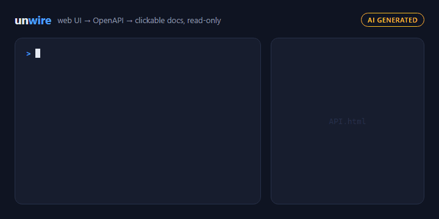
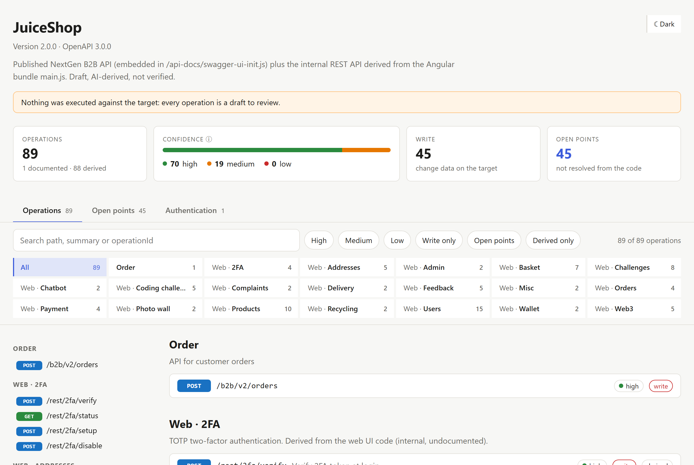

# claude-unwire
Claude Code plugin (also for Copilot CLI, Codex and Gemini CLI, see [Install](#install)) that reverse engineers the undocumented HTTP API of a web UI (router, NAS,
smart home device, web app) into an OpenAPI spec and a clickable HTML documentation.
Client code for the parts you need is planned (`unwire:code`, not implemented yet).



> [!CAUTION]
> **ONLY USE FOR HOME SYSTEMS YOU OWN.** Run Unwire only against devices and services that
> belong to you, or that you are explicitly allowed to analyze, such as the local
> [testbed](examples/testbed/README.md). Analyzing third-party systems can break their terms
> of service or the law. You are responsible for where you point it. Unwire checks the
> target first: anything outside the home network gets a warning and runs only after an
> explicit "at my own risk" confirmation.

> [!WARNING]
> **Prototype.** Unwire is an early prototype (v0.3.0). It is tested against a few home
> systems only, its output can be incomplete or wrong, and its interfaces may change without
> notice. Treat every generated spec and page as a draft to review, not as fact.

> [!NOTE]
> **AI-generated.** The code, skills and documentation of this repository were written with
> Claude (Anthropic) via Claude Code, reviewed and directed by a human. The plugin itself uses
> Claude at run time: the specs it produces are partly derived by an AI model and are marked
> as unverified (`x-unwire-verified: false`).

**Read-only by design:** Unwire finds published documentation and analyzes the static
frontend code. It never calls an API endpoint, never submits a form, never executes
downloaded JavaScript.

```
1. Discover   swagger.json, openapi.json, /v3/api-docs, Swagger UI …   GET on well-known paths
2. Analyze    HTML + JS bundles + source maps → openapi.json           static assets only
3. Document   openapi.json → API.html (primary output)                 offline, no CDN
4. Code       picked operations → client code                          not implemented yet
```

Open points (auth flow, URLs built at runtime, unknown schemas) live in the spec and show up
on the page, per operation and as one list.



*`API.html` of the testbed Juice Shop, see [examples/juiceshop/API.html](examples/juiceshop/API.html).*

## Usage
> [!IMPORTANT]
> **Needs PowerShell 7 installed** (`pwsh`). Claude checks it before the first step and helps
> you install it, nothing gets installed without your OK. See [Requirements](#requirements).

```
/unwire https://nas.example.test               # name derived from the host: Nas
/unwire http://192.168.178.1 -Name FritzBox    # an IP has no name to derive
/unwire https://nas.example.test/gitea/ with login   # name from the path: Gitea, code behind a login
/unwire ./saved-ui                             # saved copy ("Save page as"), fully offline: logins without a cookie, unreachable devices
```

**Behind a login.** No flag needed: Unwire first tries without a session, most single-page
apps serve their scripts to anyone. When the start page redirects to a login, it walks you
through copying one request as cURL from your own browser, signed in:
1. F12 → **Network**, reload with F5.
2. Right-click the first request (`document`): Chrome / Edge **Copy → Copy as cURL**,
   Firefox **Copy Value → Copy as cURL**. bash, cmd, POSIX and Windows all work.

On Windows it then opens a separate window with a masked prompt, you paste the cURL there
and close the window when the download is done. Only the cookie is taken from it. The cookie stays in that window's memory:
never in a file, a log or the chat. Unwire never logs in itself. Saying "with login" up front
skips the first try.

## Try it on the testbed
Throwaway targets on `127.0.0.1`, no volumes, made to be analyzed (Docker required). Details
and logins in [examples/testbed/README.md](examples/testbed/README.md).
```powershell
Set-Location ./examples/testbed
Copy-Item .env.example .env      # test credentials only
docker compose up -d             # Juice Shop :3000, Grafana :3001, Gitea :3003

# Gitea admin, once after every fresh start
docker compose exec -u git unwire-gitea gitea admin user create --admin --username unwire --password unwire-testbed --email unwire@example.test --must-change-password=false
```
Then in Claude Code, from the repo root (`127.0.0.1` is an IP, so `-Name` is needed):
```
/unwire http://127.0.0.1:3000 -Name JuiceShop                # undocumented REST API, Angular SPA
/unwire http://127.0.0.1:3003 -Name Gitea                    # published swagger.v1.json + web routes
/unwire http://127.0.0.1:3001 -Name Grafana with login       # session mode, admin / unwire-testbed
```
Output goes to `/unwire/<name>/`. Reset every target with `docker compose down`.

## Install
**Claude Code**
```
/plugin marketplace add LemurDaniel/claude-unwire
/plugin install unwire@claude-unwire
```

**GitHub Copilot CLI** (reads the same marketplace)
```
copilot plugin marketplace add LemurDaniel/claude-unwire
copilot plugin install unwire@claude-unwire
```

**OpenAI Codex** (CLI and ChatGPT desktop app)
```
codex plugin marketplace add LemurDaniel/claude-unwire
```
Then `/plugins` in `codex`, pick **unwire** from the marketplace **claude-unwire**.

**Gemini CLI** (an extension needs its manifest at the root, so clone first)
```powershell
git clone https://github.com/LemurDaniel/claude-unwire.git
gemini extensions install ./claude-unwire/plugins/unwire
```

Outside Claude Code there is no `/unwire` command: ask for it in plain words ("unwire
http://192.168.178.1") or call the `unwire` skill (`$unwire` in Codex). The skills ask their
confirmations in the chat there, the rules stay the same.

> [!NOTE]
> Built and tested with Claude Code. The manifests for Copilot CLI, Codex and Gemini CLI
> follow their documentation, but have not been run in those agents yet.

### Requirements
PowerShell 7+ (`pwsh`) on PATH, no modules. Unwire checks it before the first script and
asks before anything gets installed.

| OS | Install |
| --- | --- |
| Windows | `winget install --id Microsoft.PowerShell --exact --source winget` |
| macOS | `brew install --cask powershell` |
| Linux | per distro, see [Installing PowerShell on Linux](https://learn.microsoft.com/powershell/scripting/install/installing-powershell-on-linux) |

## Status
v0.3.0: all scripts work and are tested, one full run against Gitea (518 operations).
Installs in Claude Code, Copilot CLI, Codex and Gemini CLI.
Step 4, `unwire:code`, is not implemented yet.

## Development
```powershell
Invoke-ScriptAnalyzer -Path ./plugins/unwire -Recurse -Severity Warning, Error
Invoke-Pester -Path ./plugins/unwire
./plugins/unwire/skills/document/scripts/ConvertTo-UnwireHtml.ps1 -Path ./unwire/<name>/openapi.json   # re-render a page
claude --plugin-dir ./plugins/unwire      # load the plugin locally
```
